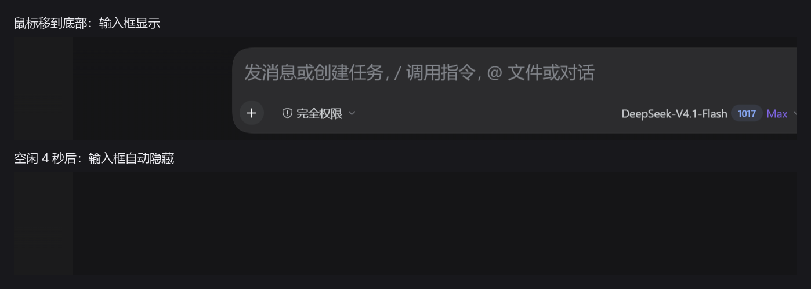

# dsh-oled-guard

为 DeepSeek Harness（DSH）的输入区和固定 UI 浮层做**闲置自动隐藏**，减少 QD-OLED 屏幕的静态高亮区域，降低烧屏风险。

> 非官方社区插件，与 DeepSeek 无隶属关系。
>
> 完整中文使用指南：[docs/使用指南.md](docs/使用指南.md)。

## 效果

- 输入区闲置 **4 秒**后，整个 composer 下滑淡出
- 鼠标移到窗口**底部约 96px** 内，输入区自动升起
- 点进输入框、正在输入、或模型选择菜单打开时，不会隐藏
- 新建会话时居中的输入框（hero 输入框）保持原样
- **其他固定/粘性 UI**（顶栏、用量环、徽章、通知等）也在闲置时淡出，鼠标一动就恢复
- **DSH 左侧栏**（`BynINW_sidebarCol`）闲置时淡出，鼠标一动恢复
- **DSH 右侧栏/右面板**（`BynINW_rightbarCol` / `OUqwTW_panel`）同样闲置淡出
- **会话顶栏**（模型/团队/模式 + 右侧图标）和 **阅读/对话/轨迹/上下文/编队标签**（`.Dc7zOa_header` / `[data-conversation-tabs]`）闲置淡出
- **Electron 原生菜单栏**（左上角“应用/编辑”）从窗口移除，避免闪烁；不再占像素
- **Ctrl+Alt+F11**：切换 DSH 窗口全屏；全屏后窗口标题栏和 `— □ ×` 消失，适合 OLED 防烧屏
- **向下折叠箭头、右侧 outline/timeline/scrollbar 轨道**：随空闲 UI 一起淡出，鼠标移动恢复
- **鼠标指针**：静止 10 秒后隐藏，移动、点击、滚轮或按键立即恢复
- 浮层扫描只处理 `position: fixed`，并排除代码块/正文/消息内容，避免代码块顶部细横条闪烁
- **Alt+Shift+O**：临时开关全部保护（状态保存在 localStorage）
- **Alt+Shift+P**：只开关“固定浮层保护”，输入框/鲸鱼逻辑不受影响



上图：鼠标移到底部时输入框显示；下图：空闲 4 秒后输入框自动隐藏（截图仅保留输入框区域，未包含聊天内容）。固定浮层使用同一套空闲逻辑，效果类似。

## 设置面板与自定义热键

按 `Alt+Shift+K` 打开设置面板：

| 默认热键 | 作用 |
|---|---|
| `Alt+Shift+O` | 总开关（输入框 / 鲸鱼 / 浮层） |
| `Alt+Shift+P` | 只开关固定浮层保护 |
| `Alt+Shift+K` | 打开设置面板 |

面板里可以：

- 开关总保护、开关固定浮层保护
- 点击快捷键输入框后直接按新组合键（字母键必须带 Ctrl/Alt/Shift/Meta）
- 保存后立即生效，配置保存在本机 `localStorage`

忘记自定义热键时，在控制台执行 `window.__dshOledGuard.openSettings()` 即可重新打开设置。

## 安装

### 方式一：npm（发布后可用）

```bash
dsh plugin add dsh-oled-guard
```

### 方式二：从源码本地链接

```bash
git clone https://github.com/wangzimu2007/dsh-oled-guard.git
dsh plugin add "link:$(pwd)/dsh-oled-guard"
```

或者手动把 `"dsh-oled-guard": "link:<绝对路径>"` 加进 profile 的 `package.json`，并把 `dsh-oled-guard` 加进 `dsh.profile.bundles`，然后运行 `dsh plugin --profile desktop install`。

安装后**重启 DSH** 生效。

## 工作原理

插件是“客户端半边 + 很小的宿主半边”，不改 DSH 源码：

| 钩子/机制 | 用途 |
|---|---|
| `[data-composer-seat]` | 输入区容器（`data-conversation-region="composer"`） |
| `[data-composer-input]` | 可编辑输入框（用于判断焦点） |
| `[role="menu"]` | 菜单打开时暂停隐藏 |
| `.dshwv-root` | 右下角鲸鱼组件 |
| `.BynINW_sidebarCol` | DSH 左侧栏（AppFrame 的 sidebar 列） |
| `.BynINW_rightbarCol` / `.OUqwTW_panel` | DSH 右侧栏/右面板 |
| `.Dc7zOa_header` / `header[data-window-drag]` | 会话顶栏（模型/团队/模式和右侧图标） |
| `[data-conversation-tabs]` | 会话标签行（阅读/对话/轨迹/上下文/编队） |
| 运行时扫描 `position: fixed / sticky` | 其他固定 UI 浮层（面积小于视口 60%，全屏背景/遮罩不处理） |
| Electron `removeMenu` / `setMenuBarVisibility` | 左上角原生菜单栏移除（宿主半边） |

通过 `getBoundingClientRect()` 区分"底部停靠"和"新建会话居中"两种布局；居中时不隐藏。

### 固定浮层的排除规则

以下元素不会被自动隐藏：

- 全屏或超过视口面积 60% 的层（背景、壁纸、遮罩）
- `[role="menu"]`、`[role="dialog"]`、`[role="alertdialog"]`、`[role="tooltip"]`
- 常见 UI 组件弹层（`.el-popper`、`.el-overlay`、`.ant-popover`、`.ant-modal` 等）
- 包含当前焦点的元素
- 带 `data-dsh-oled-keep` 属性的元素及其子树
- 输入区和鲸鱼自身

### 自定义选择器

如果在某些版本里侧边栏/顶栏不是 `fixed/sticky`，或者想额外隐藏某个组件：

```js
// 强制包含（即使不是 fixed/sticky）
localStorage.setItem("dsh-oled-guard-extra", JSON.stringify([".my-sidebar", "#my-badge"]));
// 强制排除
localStorage.setItem("dsh-oled-guard-exclude", JSON.stringify([".keep-visible"]));
```

改完刷新 DSH 窗口生效。也可以用 `data-dsh-oled-keep` 保护单个元素。

## 兼容性与限制

- 在 DSH desktop **44.7.0**（runtime **0.2.1-rc.2**）上验证通过
- DSH 更新后 DOM 钩子可能变化；届时插件会自动放行（fail-open），不会破坏界面
- 纯本地、无网络请求、无遥测
- 只影响 DSH 输入区和固定浮层，不改变消息内容区的渲染

## 目录结构

```
dsh-oled-guard/
├── package.json
├── cordis.patch.yml
├── lib/
│   ├── index.js     # 宿主半边（空逻辑，让插件成为 cordis 树上的条目）
│   └── client.js    # 客户端半边（CSS + 鼠标/焦点监听）
├── LICENSE
└── README.md
```

## 免责声明

插件按"现状"提供，不保证适配所有 DSH 版本。使用前请自行确认不会影响你的工作流；若出现异常，按 `Alt+Shift+O` 关闭，或从 profile 中移除插件。

## License

MIT
