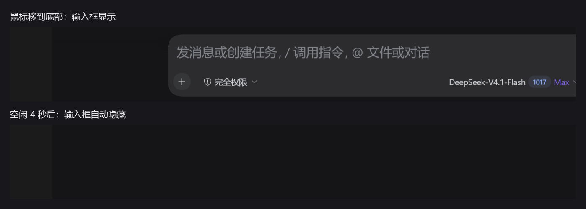

# dsh-oled-guard

为 DeepSeek Harness（DSH）的输入区做**闲置自动隐藏**，减少 QD-OLED 屏幕的静态高亮区域，降低烧屏风险。

> 非官方社区插件，与 DeepSeek 无隶属关系。

## 效果

- 输入区闲置 **4 秒**后，整个 composer 下滑淡出
- 鼠标移到窗口**底部约 96px** 内，输入区自动升起
- 点进输入框、正在输入、或模型选择菜单打开时，不会隐藏
- 新建会话时居中的输入框（hero 输入框）保持原样
- **Alt+Shift+O**：临时开关（状态保存在 localStorage）



上图：鼠标移到底部时输入框显示；下图：空闲 4 秒后输入框自动隐藏（截图仅保留输入框区域，未包含聊天内容）。

## 安装

### 方式一：npm（发布后可用）

```bash
dsh plugin add dsh-oled-guard
```

### 方式二：从源码本地链接

```bash
git clone https://github.com/wangzimu2007/dsh-oled-guard.git
dsh plugin add "link:$(pwd)/dsh-oled-guard"
```

或者手动把 `"dsh-oled-guard": "link:<绝对路径>"` 加进 profile 的 `package.json`，并把 `dsh-oled-guard` 加进 `dsh.profile.bundles`，然后运行 `dsh plugin --profile desktop install`。

安装后**重启 DSH** 生效。

## 工作原理

插件是纯客户端插件，不改 DSH 源码，只依赖 DSH 客户端里稳定的 DOM 钩子：

| 钩子 | 用途 |
|---|---|
| `[data-composer-seat]` | 输入区容器（`data-conversation-region="composer"`） |
| `[data-composer-input]` | 可编辑输入框（用于判断焦点） |
| `[role="menu"]` | 菜单打开时暂停隐藏 |

通过 `getBoundingClientRect()` 区分"底部停靠"和"新建会话居中"两种布局；居中时不隐藏。

## 兼容性与限制

- 在 DSH desktop **44.7.0**（runtime **0.2.1-rc.2**）上验证通过
- DSH 更新后 DOM 钩子可能变化；届时插件会自动放行（fail-open），不会破坏界面
- 纯本地、无网络请求、无遥测
- 只影响 DSH 输入区，不改变消息内容区的渲染

## 目录结构

```
dsh-oled-guard/
├── package.json
├── cordis.patch.yml
├── lib/
│   ├── index.js     # 宿主半边（空逻辑，让插件成为 cordis 树上的条目）
│   └── client.js    # 客户端半边（CSS + 鼠标/焦点监听）
├── LICENSE
└── README.md
```

## 免责声明

插件按"现状"提供，不保证适配所有 DSH 版本。使用前请自行确认不会影响你的工作流；若出现异常，按 `Alt+Shift+O` 关闭，或从 profile 中移除插件。

## License

MIT
